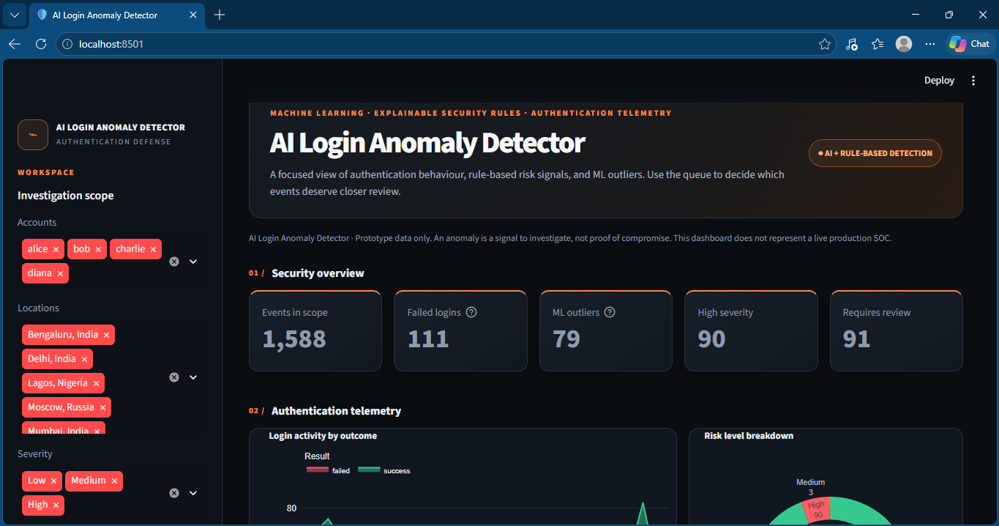
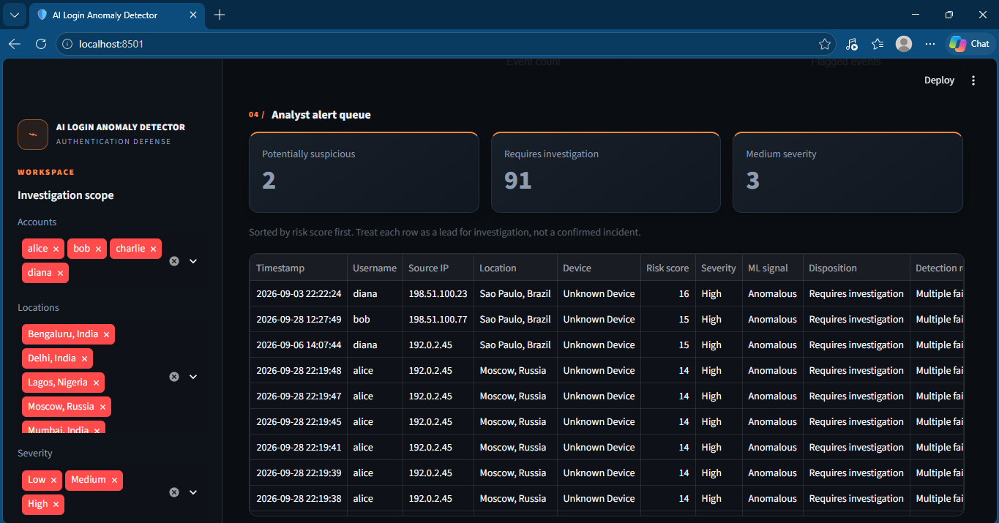
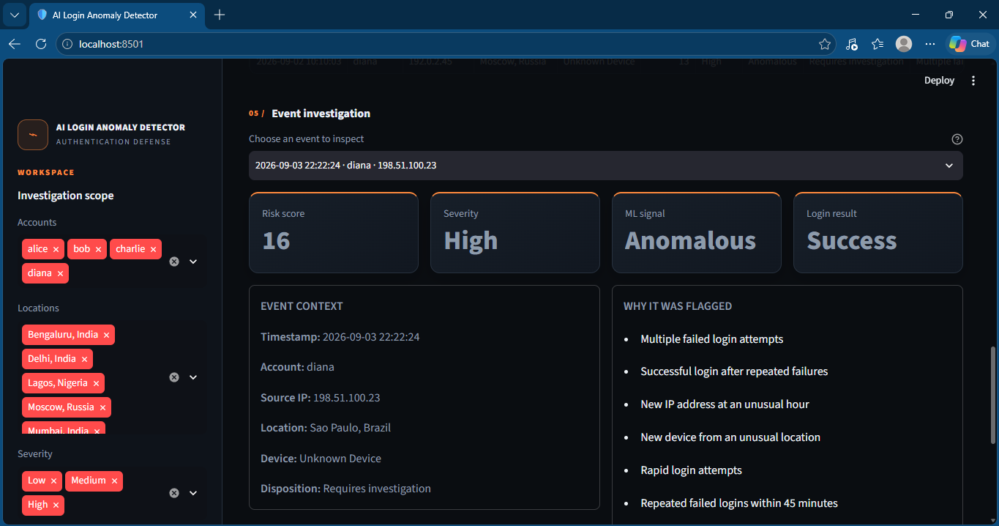
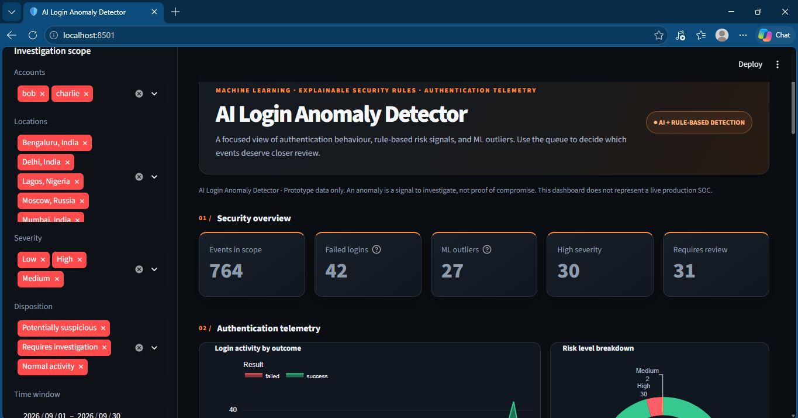

# AI Login Anomaly Detector

An educational **Blue Team project** that analyses login records and flags potentially suspicious authentication activity. It combines explainable detection rules, a simple risk score, and an Isolation Forest model, then presents the results in a Streamlit dashboard.

> **Important:** This project uses synthetic login data. An anomaly is a signal to investigate, not proof of an attack. It is a learning prototype, not a production security system.

**Author:** Manasa Umashankar  
**Repository:** https://github.com/ManasaUmashankar/AI-Login-Anomaly-Detector

---

## What it does

1. Loads and cleans login records.
2. Extracts useful signals such as login time, unfamiliar IP/device/location, and repeated attempts.
3. Applies explainable rules and assigns a risk score.
4. Uses Isolation Forest to identify statistically unusual login activity.
5. Combines the results and displays alerts in a dashboard.

## Built with

- **Python** — core application and data processing
- **Pandas / NumPy** — data handling
- **Scikit-learn** — Isolation Forest
- **Streamlit / Plotly** — interactive dashboard
- **pytest** — automated tests
- **FastAPI / Docker** — optional API demonstration and container workflow

## Project structure

```text
AI-Login-Anomaly-Detector/
├── data/                 # Synthetic login dataset
├── models/               # Saved Isolation Forest model
├── src/                  # Preprocessing, features, rules and detection
├── dashboard/
│   └── app.py            # Streamlit dashboard
├── tests/                # Automated tests
├── docs/                 # Architecture, evaluation and demo notes
├── Dockerfile
├── docker-compose.yml
├── requirements.txt
└── README.md
```

## Run locally

Requires Python 3.10 or newer.

### 1. Clone and install

```bash
git clone https://github.com/ManasaUmashankar/AI-Login-Anomaly-Detector.git
cd AI-Login-Anomaly-Detector

python -m venv .venv
```

Activate the environment:

**Windows PowerShell**
```powershell
.\.venv\Scripts\Activate.ps1
```

**Linux / macOS**
```bash
source .venv/bin/activate
```

Install dependencies:

```bash
pip install -r requirements.txt
```

### 2. Run the detection pipeline

```bash
python -m src.generate_dataset
python -m src.anomaly_detector
```

The dataset generator creates the synthetic login records. The detection pipeline preprocesses the records, builds features, applies the rules and model, and saves the results used by the dashboard.

### 3. Start the dashboard

```bash
python -m streamlit run dashboard/app.py
```

Open the local URL printed in the terminal (usually http://localhost:8501).

## Dashboard

The dashboard provides:
- Login activity and summary metrics
- Risk-level breakdown
- Filters for reviewing login events
- An alert table with risk scores and detection reasons
- Context for investigating a selected event

### Screenshots

| Security overview | Analyst alert queue |
|---|---|
|  |  |

| Event investigation | Filtered dashboard |
|---|---|
|  |  |

## How detection works

**Rule-based detection:** checks for patterns such as repeated failed logins, unfamiliar login context, unusual login times, and rapid attempts. Each triggered rule contributes to a readable explanation and project-specific risk score.

**Machine learning:** Isolation Forest identifies login records that are statistically different from the data it was trained on. It does not understand intent and cannot determine by itself whether an event is malicious.

**Combined result:** the rule-based risk level and ML result are combined to prioritise events for review. The dashboard shows the result and the reasons behind it.

## Evaluation and testing

Run the automated tests:

```bash
python -m pytest -q
```

Run the evaluation scripts:

```bash
python -m src.evaluate_model
python -m src.stress_test_evaluation
python -m src.evaluation_suite
```

The evaluation uses chronological splits and synthetic scenarios. The dataset's generated labels share some signals with the rules, so strong results on this dataset do **not** demonstrate real-world detection performance. The controlled stress test also includes ambiguous and benign edge cases. See [the evaluation guide](docs/evaluation-guide.md) for methods, results, and limitations.

## Optional API and Docker

The repository also includes a FastAPI endpoint for scoring a submitted login event. It is an optional demonstration; the Streamlit dashboard is the main way to explore the project.

To run the API locally:

```bash
uvicorn src.api:app --reload
```

The prediction endpoint requires an API key configured through `DETECTOR_API_KEY`. See `.env.example` and the API documentation in the repository before making requests.

Docker Compose can run the API container locally:

```bash
cp .env.example .env
# Replace DETECTOR_API_KEY in .env with a long random value
docker compose up --build
```

The API is bound to localhost by default. Do not expose this educational prototype directly to the internet.

## Limitations

- The included dataset is synthetic, not real organisation login data.
- Detection thresholds and risk scores are project-specific choices.
- Unusual activity can be legitimate; alerts need human review.
- The project does not provide live identity-provider ingestion or a production alerting workflow.
- Performance on synthetic data does not establish how the detector will perform in a real environment.

## Learning outcomes

This project demonstrates practical use of Python for defensive security analytics: processing authentication logs, creating behavioural features, writing explainable detection rules, applying an anomaly-detection model, evaluating results, testing code, and presenting findings in a dashboard.

---

**Disclaimer:** This is an educational defensive-security project. It is not intended for production monitoring or as a substitute for a properly validated security monitoring system.
