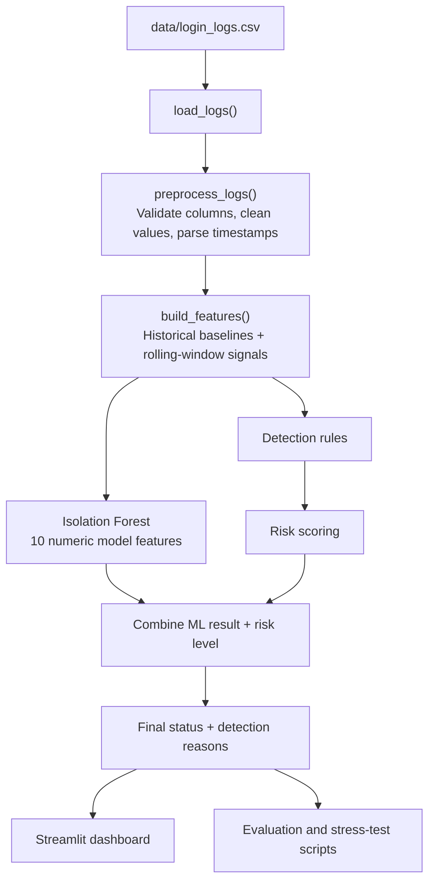

# Architecture: AI Login Anomaly Detector

This document describes the implemented flow in this repository. The system analyses a fixed synthetic login dataset; it is not connected to a live identity provider or production SIEM.

## End-to-end flow



## Main components

| Component | Responsibility |
|---|---|
| `src/read_dataset.py` | Loads the login-log dataset. |
| `src/preprocessing.py` | Validates required columns, cleans text, parses timestamps, removes exact duplicates and invalid rows, and sorts events chronologically. |
| `src/feature_engineering.py` | Builds time features, compares events with earlier user history, computes rolling-window counts, and counts distinct accounts failing from the same source IP in a 15-minute window. Equal timestamps are processed in batches to avoid row-order-dependent historical features. |
| `src/detection_rules.py` | Applies explainable rules and calculates a project-specific risk score and risk level. |
| `src/anomaly_detector.py` | Trains or loads the versioned Isolation Forest artifact, produces ML anomaly results, appends ML reasons, and combines risk level and ML output into a final status. |
| `dashboard/app.py` | Displays metrics, charts, filters, the alert queue, and selected-event investigation context. The refresh control clears cached results and reruns the Streamlit app. |
| `src/evaluate_model.py` | Evaluates later chronological windows using models fitted on earlier history and compares the model with a risk-score baseline. |
| `src/stress_test_evaluation.py` | Evaluates controlled synthetic edge cases, including clearly labelled and ambiguous scenarios. |
| `tests/` | Regression tests for pipeline behaviour and edge cases. |

## How the detection result is formed

1. **Preprocess:** clean and validate the input rows without removing unusual but valid login events.
2. **Engineer features:** derive time, new-IP/device/location, login-frequency, rolling failed/successful-login, and cross-account source-IP signals.
3. **Run two detection paths:** the rule layer produces readable reasons and a risk score; Isolation Forest identifies statistically unusual feature combinations.
4. **Combine outputs:** high risk requires investigation; medium risk is prioritised according to the ML result; low-risk ML outliers are marked potentially suspicious. See the [Detection Methodology](../README.md#detection-methodology) in the README for the full decision table.
5. **Review in the dashboard:** analysts can filter the results, select an alert, inspect its reasons and context, and request a refresh of the cached pipeline results.

## Model and evaluation boundaries

- Isolation Forest is trained without the synthetic ground-truth labels. Labels are used by evaluation scripts to calculate metrics.
- The saved model is versioned against the feature semantics. A stale or missing artifact is retrained when the pipeline is run in retraining mode; the dashboard loads the configured artifact and validates its version.
- Evaluation uses chronological holdout windows so the model is fitted on earlier events and scored on later events. Equal timestamps are kept together at split boundaries.
- The dataset and edge-case stress scenarios are synthetic and hand-designed. Metrics are useful for testing and comparison, not evidence of production-level accuracy.
- An alert is an investigation signal, not proof of malicious activity.

## Run the project

From the repository root with the virtual environment active:

```powershell
python -m src.anomaly_detector
python -m src.evaluate_model
python -m src.stress_test_evaluation
python -m pytest -v
python -m streamlit run dashboard/app.py
```

For environment setup and dataset details, see the [README](../README.md).
